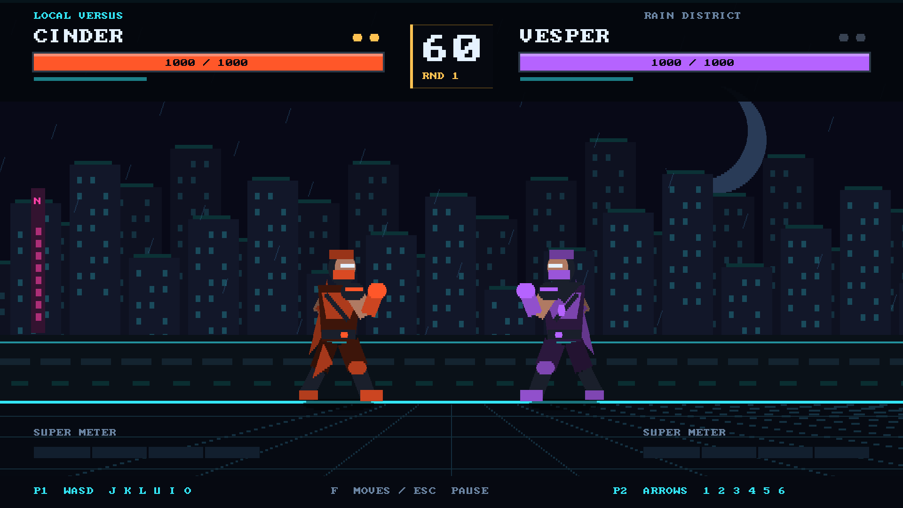

# NEON CLASH

Оригинальный 2D-файтинг на AIGE: шесть бойцов, три арены и бои до двух побед по раундам. Создан с нуля в этом проекте. Использованы локальная документация AIGE, API и существующий движок; сторонние игровые движки, графические ассеты и сетевые сервисы не использованы. Исходники AIGE не изменены.



## Запуск

Скачайте архив из [Releases](https://github.com/pepechka-kun/neon-clash/releases/latest) и распакуйте его. Дважды нажмите **`Neon Clash.app`** или **`Play.command`**. Готовая сборка находится в `dist/neon-clash`; Rust для её запуска не нужен. Сборка подготовлена для macOS Apple Silicon. В репозитории хранятся исходники; приложение и исполняемый файл поставляются в архиве релиза.

Окно по умолчанию — **1920×1080 физических пикселей (Full HD)**. Камера AIGE масштабирует всю сцену вдвое: арена, бойцы и интерфейс заполняют кадр. На Retina размеры окна в логических единицах macOS могут быть меньше; игровой кадр при этом остаётся 1920×1080. Если уже запущена старая версия, закройте её и снова откройте приложение.

```sh
./Play.command
```

В меню: стрелки или WASD, Enter — подтверждение, Escape — назад. На экране выбора Q/E меняют арену, Z/X — сложность ИИ. В локальном режиме персонажи выбираются по очереди. F открывает справочник приёмов; бой на время чтения останавливается.

## Режимы

- **Arcade** — пять соперников, три сложности, смена арены и финальное звание Signal Champion. После победы Enter запускает следующий бой; после поражения — повторный.
- **Local Versus** — два игрока за одной клавиатурой.
- **Training** — бесконечный раунд, восстановление суперметра, счётчик комбо. B переключает манекен: бездействие, блок, ИИ. T восстанавливает здоровье, позиции и метр.
- **Watch the Fight** — бой двух ИИ.

## Управление

| Действие | Игрок 1 | Игрок 2 |
|---|---|---|
| Движение | A / D | ← / → |
| Прыжок | W | ↑ |
| Присесть | S | ↓ |
| Удар рукой | J | 1 |
| Удар ногой сверху | K | 2 |
| Держать блок | L | 3 |
| Спецприём | U | 4 |
| Бросок / выход из броска | I | 5 |
| Суперудар, нужен полный метр | O | 6 |
| Подсечка | S + K | ↓ + 2 |
| Апперкот с подбрасыванием | S + U | ↓ + 4 |
| Рывок | дважды вперёд | дважды вперёд |
| Спецприём движением | вниз, вперёд, J | вниз, вперёд, 1 |

Escape ставит бой на паузу; Enter или Escape продолжают. R на паузе или после матча возвращает к выбору бойцов. Во время паузы можно открыть F.

Начальное комбо: **J → J → K → U**. Нажимайте следующий удар сразу после попадания; игра принимает ввод во время короткой остановки кадра. Для игрока 2: **1 → 1 → 2 → 4**. Отмена идёт от слабого удара к сильному, затем к спецприёму и суперудару. Комбо действует только пока противник оглушён или находится в воздухе; последующие попадания наносят меньше урона.

Блок стоя защищает от обычных ударов и ударов сверху. Блок сидя защищает от подсечек, но пропускает удары сверху. Броски пробивают блок: противодействуйте собственным броском в момент захвата. Шкала защиты истощается от блокирования, восстанавливается со временем и при обнулении вызывает Guard Break. Урон по блоку от спецприёмов не может добить противника. Прыжок позволяет избежать подсечки; снаряды можно пропустить над собой, присев. Один приём не наносит повторный урон каждый активный кадр. Одновременные попадания допускают обмен ударами и двойной нокаут.

## Бойцы

| Боец | Особенность |
|---|---|
| Cinder | Сбалансированный боец, мощный огненный снаряд |
| Vesper | Самое быстрое перемещение и быстрый наступательный рывок |
| Kairo | Быстрый электрический снаряд с короткой подготовкой |
| Rook | Медленный тяжёлый боец, усиленный бросок и бронированный натиск; броски обходят броню |
| Nyx | Медленный ледяной снаряд с длительным оглушением |
| Echo | Наступательный рывок с ударом сверху против нижнего блока |

Арены: Rain District, Red Sanctum, Reactor Zero. Персонажи имеют анимированные стойки, ходьбу, прыжки, приседания, защиту, удары, получение урона и падения. Вся графика рисуется AIGE `DebugDraw`; шрифт встроен в движок. Интерфейс на английском из-за ASCII-шрифта AIGE.

## Сборка и проверки

Нужны установленный Rust с поддержкой edition 2024, Git и доступ к приватному репозиторию [AIGE-by-Devin](https://github.com/pepechka-kun/AIGE-by-Devin). Движок автоматически загружается Cargo; версия закреплена на `f998236bc44bf4683b1d8b607e037bb7ef70c040`, на которой игра была разработана и проверена. Абсолютные пути к дискам не нужны. Для HTTPS-доступа Git должен быть авторизован: при использовании GitHub CLI выполните `gh auth login` и `gh auth setup-git`.

```sh
gh repo clone pepechka-kun/neon-clash
cd neon-clash
cargo fetch --locked
./scripts/build.sh
cargo fmt --check
cargo clippy --offline --all-targets -- -D warnings
cargo test --offline -- --nocapture
python3 scripts/verify_mcp.py dist/neon-clash
./scripts/verify_native.sh
```

После первой загрузки зависимостей проверки с `--offline` работают без сети. Каталог сборки можно переопределить стандартной переменной `CARGO_TARGET_DIR`.

`tests/gameplay.rs` проверяет меню, дальность и кадры ударов, защиту, броски, обмен ударами, комбо, прыжки, спецприёмы, суперметр, границы арены, раунды, тренировку, аркадную сетку, ИИ, точное восстановление состояния и детерминизм. GPU-проверка сохраняет кадры всех экранов и арен в `artifacts/`; отсутствие GPU объявляется явно.

`scripts/verify_mcp.py` запускает настоящий игровой процесс, проходит выбор персонажа и четырёхударное комбо только клавиатурными событиями через MCP, проверяет снимок/восстановление и воспроизведение записи. `examples/native_smoke.rs` открывает нативное окно, выполняет меню и бой, проверяет реальные показанные GPU-кадры и отсутствие ошибок.

На macOS оконную проверку запускает `verify_native.sh` через LaunchServices. Запуск из фонового терминала может оставить окно перекрытым: AIGE в этом случае корректно пропускает показ кадров, и тест явно завершается ошибкой вместо ложного успеха. Отчёт записывается в `artifacts/native-report.json`.

Проверка требует разблокированного экрана macOS. При заблокированной сессии скрипт сообщает причину и завершается с кодом 3. Обновлённая release-сборка проверена в нативном окне **1920×1080**: 170 показанных кадров за 180 тиков без ошибок. Также прошли 26 тестов, GPU-снимки на Apple M4 / Metal, MCP-комбо из 4 ударов на 284 урона и replay из 149 тиков с совпадением хеша.

## AIGE / управление агентом

```sh
./dist/neon-clash --headless --agent stdio --seed 42
./dist/neon-clash --agent socket=/tmp/neon-clash.sock
./dist/neon-clash --record-replay artifacts/my-fight.json
./dist/neon-clash --replay artifacts/my-fight.json
```

В агентском режиме симуляция ждёт `step`. Проба `info` содержит правила, управление и состояние; `match_finished` сообщает об окончании матча; `hit_connected` — об остановке кадра при попадании. Ресурс `game` содержит целочисленную боевую модель. Все движения и таймеры используют фиксированные целочисленные единицы; визуальная проекция не участвует в расчёте столкновений. Seed, ввод, снимки и replay обслуживаются самим AIGE.

## Границы реализации

Это самостоятельный 2D-файтинг с процедурной графикой. Звука, сетевых матчей, поддержки геймпадов и 3D нет; в изученном API AIGE нет готовой аудиосистемы и 3D-боевой сцены. Логическая сцена 960×540 выводится камерой с масштабом 2 в окно 1920×1080; произвольные размеры окна пока не подгоняют масштаб автоматически. Игровой контент и персонажи оригинальные.
